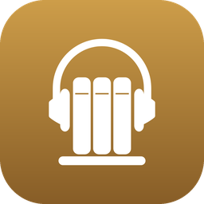
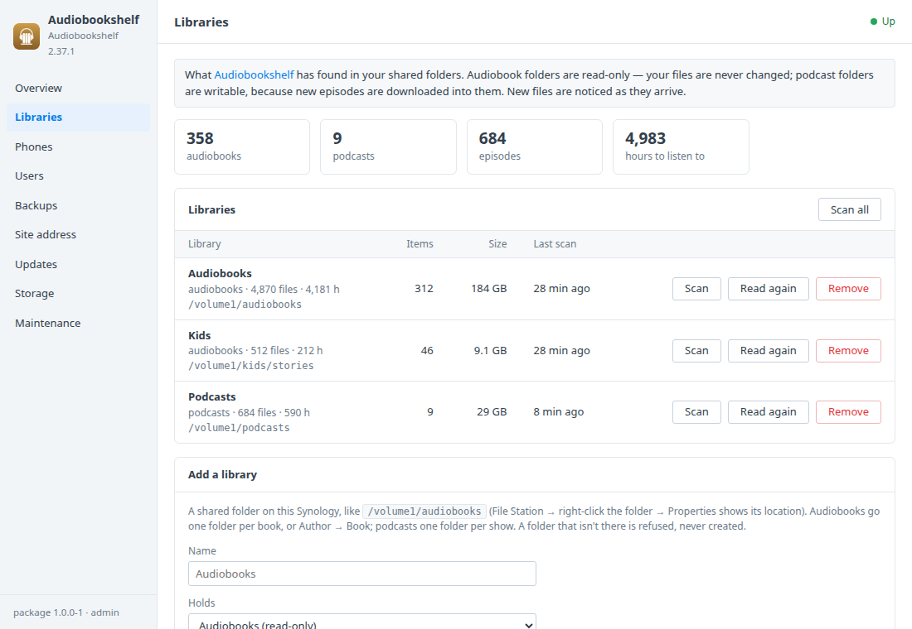
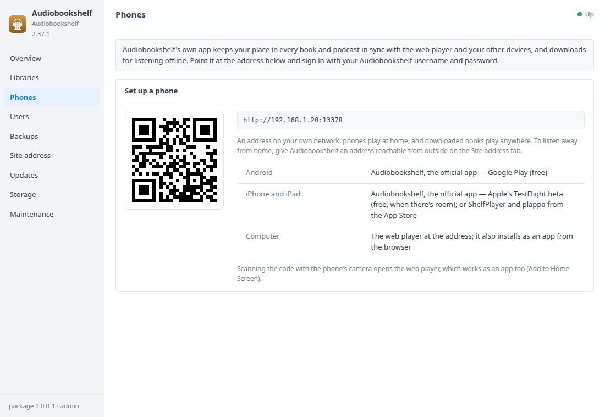
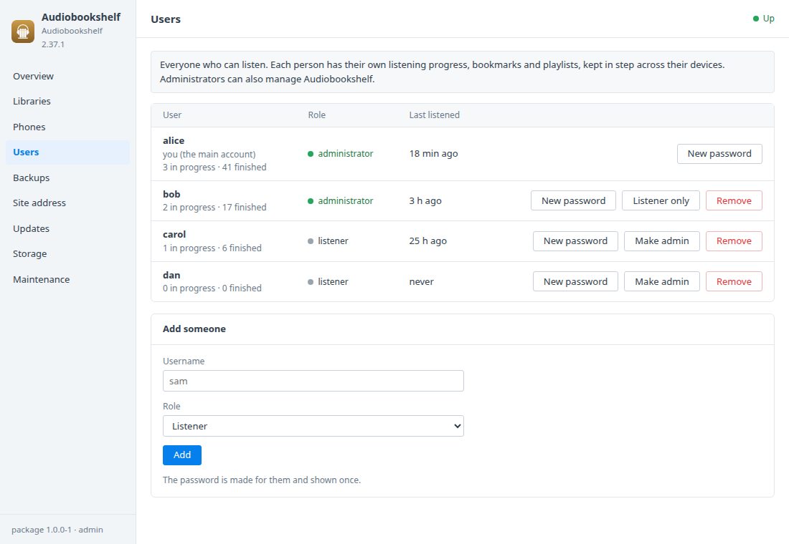

# Audiobookshelf for Synology DSM

A DSM 7 package that installs [Audiobookshelf](https://www.audiobookshelf.org)
in Container Manager. Audiobookshelf turns the audiobooks and podcasts in your
shared folders into your own listening service: a web player, plus phone apps
that remember where you stopped on every device. It reads your audiobooks and
never changes them. An **Audiobookshelf** window in DSM covers:
- libraries and scans;
- setting up phones with a QR code;
- users;
- backups that keep everyone's listening progress;
- updates.

Built on the [DSM app chassis](https://github.com/tombruton87/dsm-app-chassis).

## Download

### **[⬇ Download audiobookshelf.spk](https://github.com/tombruton87/audiobookshelf-dsm/releases/latest/download/audiobookshelf.spk)**

[](https://github.com/tombruton87/audiobookshelf-dsm/releases/latest)

That link always gives the newest version. Older ones are on the
[Releases](https://github.com/tombruton87/audiobookshelf-dsm/releases) page.

Install: Package Center → Manual Install → the `.spk` (DSM 7.2.1+; Container
Manager is installed first if missing). The wizard asks for:
- the NAS's address;
- a port (13378 by default);
- a time zone;
- your audiobooks folder (usually `/volume1/audiobooks`) and, if you like, a
  podcasts folder;
- your username.

Your account — Audiobookshelf's main (root) account — is made at the first
start, with a strong password shown once in the window. The folders you gave
become the *Audiobooks* and *Podcasts* libraries.

## What the DSM window adds

- **Libraries**
  - What Audiobookshelf found: books, podcasts, episodes and hours, per
    library and in all.
  - **Scan** a library or all of them, or **Read again** from scratch.
  - **Add a library** from a shared folder. Audiobook folders are mounted
    read-only, so your files are never changed. Podcast folders are writable,
    because Audiobookshelf downloads new episodes into them. A folder that
    isn't there is refused, never created.
  - **Remove** a library. Its files stay; its listening progress goes.
  - A folder that goes away (a USB disk, a renamed share) shows as waiting.
    Audiobookshelf reads it again within ten minutes of it coming back.
- **Phones** — the address as a QR code, and the apps: the official
  Audiobookshelf app on Android (Google Play) and iPhone (Apple's TestFlight
  beta), plus ShelfPlayer and plappa from the App Store.
- **Users** — add people (each has their own progress, bookmarks and
  playlists), with a password made for them and shown once. You can also make
  a new password, make or unmake an administrator, or remove someone, and see
  how many books each is listening to and has finished. The main account is
  protected.
- **Backups, updates, storage, maintenance** — one file holds:
  - a consistent copy of Audiobookshelf's database (everyone's listening
    progress, bookmarks, collections, playlists, users and settings);
  - its metadata: covers, author pictures, item details;
  - the library folders as they were mounted, so a restore finds them again.

  Backups run nightly or on demand, with restore. The audiobooks and podcasts
  themselves stay where they are. You can also:
  - update to Audiobookshelf's newest release from inside DSM (a backup is
    made first);
  - update to a newer package;
  - make a redacted support report;
  - read the logs;
  - remove Audiobookshelf and everything with it.

### Backups: the package's, and Audiobookshelf's own

Audiobookshelf has its own backups (Settings → Backups): a zip of its database
and metadata, restored from inside Audiobookshelf. The package makes its own
instead, at the file level, with the server running:
- the database is copied with `sqlite3 .backup`, so it's consistent;
- the metadata comes without what Audiobookshelf makes again (cache, streams,
  logs), and without Audiobookshelf's own backups, which would double it;
- the package's settings come too: the address, the port, the library folders.

A restore stops Audiobookshelf, puts the database and metadata back, mounts the
library folders of that time and starts it again. A backup of how things were
just before is made first. Audiobookshelf's own backups stay in its volume
through a restore, so both kinds can be used.

## Screenshots

| | |
|---|---|
|  |  |
|  | |

## How it works

Audiobookshelf (`ghcr.io/advplyr/audiobookshelf`, pinned to a release) runs as
one container:
- its database is in the `audiobookshelf_config` volume;
- covers and item details are in `audiobookshelf_metadata`;
- each library folder is bind-mounted at its own path, so Audiobookshelf shows
  the paths you know (`/volume1/audiobooks`). There are four places for
  audiobook folders (read-only) and four for podcast folders (writable). A
  folder inside one already mounted needs no place of its own.

The window works through Audiobookshelf's own API with an API key of the main
account. It's called *DSM package* in Audiobookshelf → Settings → API Keys, and
is kept root-only in the package's settings. If it's removed there, the package
makes itself a new one with a five-minute token signed by the server's own
secret. Your password is never stored.

Audiobookshelf has no HTTPS of its own. For listening away from home, put DSM's
reverse proxy with your domain and DSM's certificate in front (the Site address
tab has the steps).

## Layout

```
chassis/          the DSM app chassis (git submodule)
package.conf      name, title, services, volumes, images, port, texts
app/compose.yaml  Audiobookshelf, with its places for library folders
setup/app.sh      the hooks: your account and the package's key, libraries and folders, users, updates, backups
ui/               Libraries, Phones and Users tabs; CGI validation (free text travels base64url)
wizard/           the Audiobookshelf page of the install wizard
tests/            steps for the chassis harness, with tiny MP3s made on the spot
```

Test: `chassis/tests/e2e.sh . up && chassis/tests/e2e.sh . act` on any Linux
box with Docker. With `ABS_E2E_LATER=1`, `up` starts with an audiobooks folder
that isn't there yet, to see it picked up once it is.

Release: bump `VERSION`, add the changes to `CHANGELOG.md`, build, then attach
the package twice, under its versioned name and as `audiobookshelf.spk`:

```bash
cp dist/audiobookshelf-X.Y.Z-1.spk /tmp/audiobookshelf.spk
gh release create vX.Y.Z dist/audiobookshelf-X.Y.Z-1.spk /tmp/audiobookshelf.spk
```

Build: `chassis/build.sh . N`.

## Credits

The icon is Audiobookshelf's own mark on a DSM-style tile in its gold.
Audiobookshelf is GPL-3.0 software by advplyr and contributors. This package is
not affiliated with Audiobookshelf or Synology.
